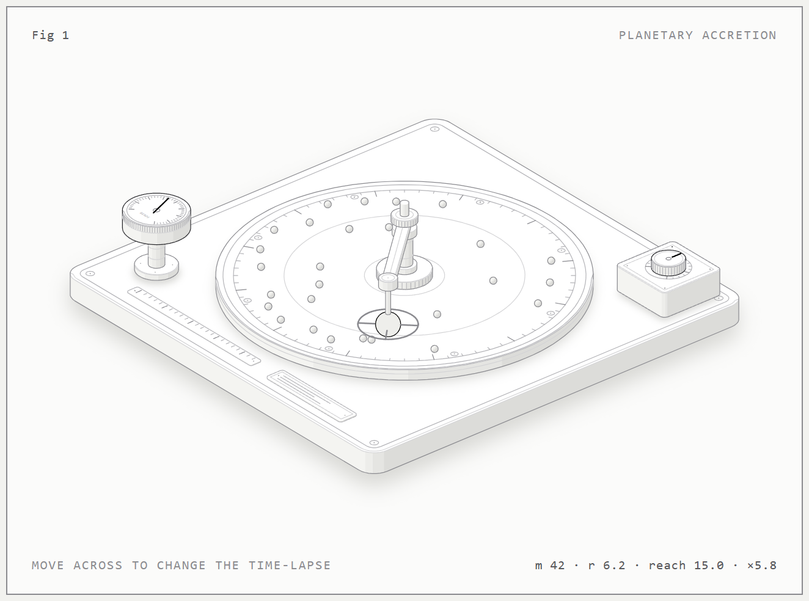
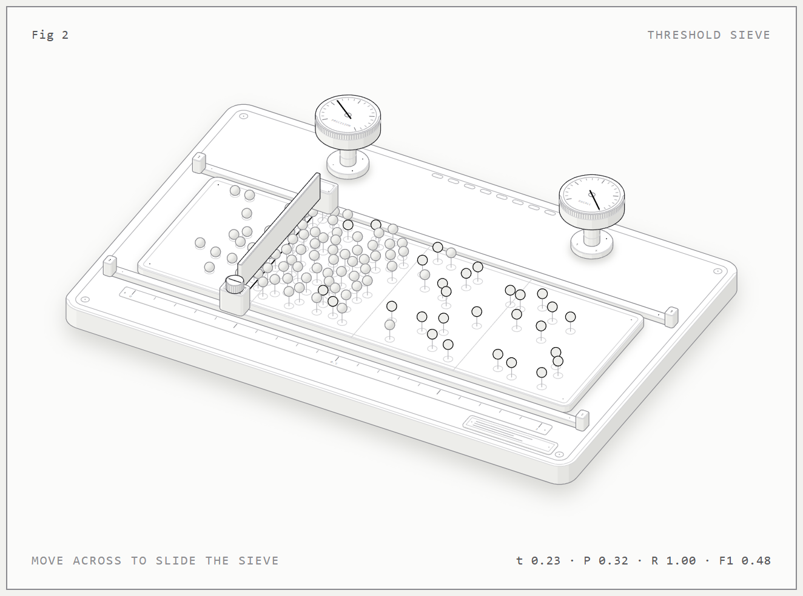
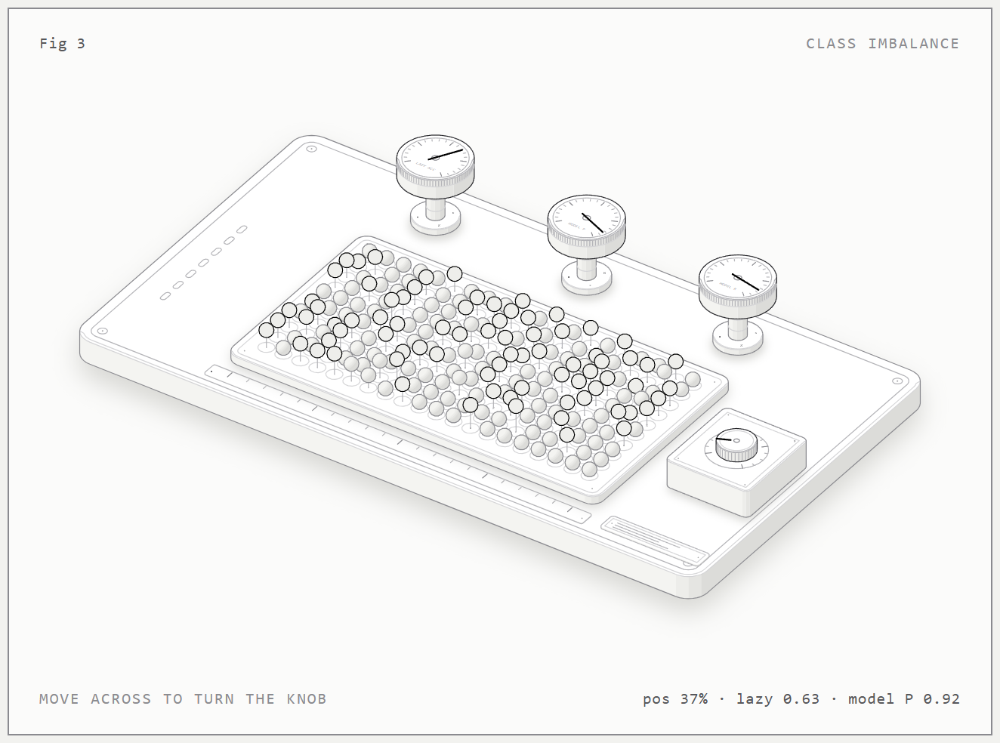

# anatomy-tryouts

Interactive isometric figures: small physical machines that explain an idea. Built with the anatomy skill's kit (`kit/`).

| Figure | Idea |
|---|---|
| [accretion](accretion/) | Planetary accretion: a body sweeping up dust, with gravitational focusing |
| [threshold-sieve](threshold-sieve/) | Classifier threshold: sliding the sieve trades precision against recall |
| [class-imbalance](class-imbalance/) | Why accuracy lies: thin the positives and watch precision collapse |

More are planned: see [IDEAS.md](IDEAS.md).

## Run one
```bash
cd accretion
node build.mjs          # dark  -> accretion.html
node build.mjs --light  # light -> accretion-light.html
```
Open the HTML file in a browser. Move the pointer across the figure to change the time-lapse; R restarts.






