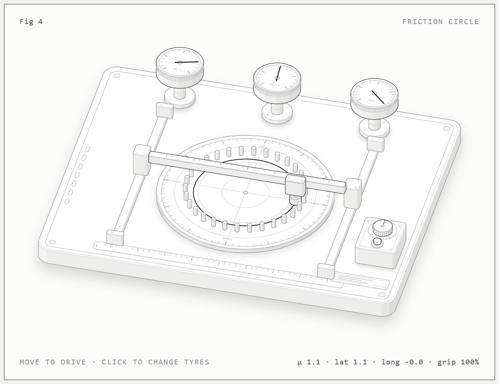
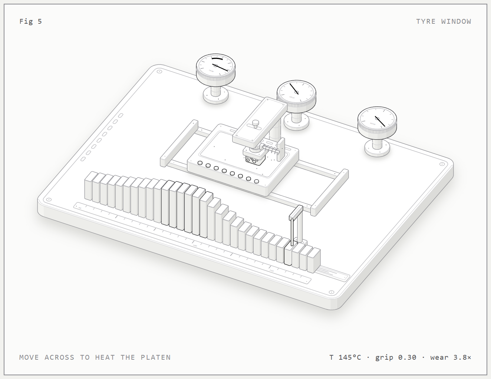
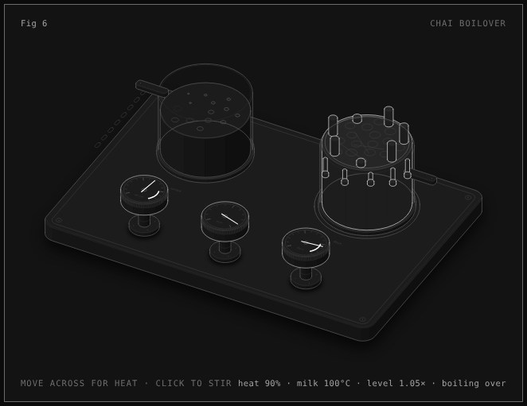
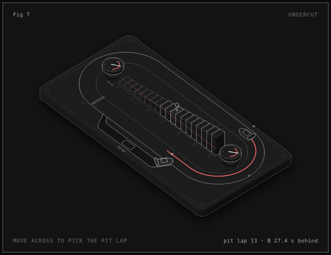
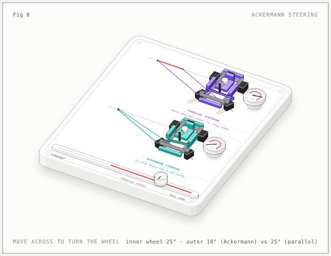
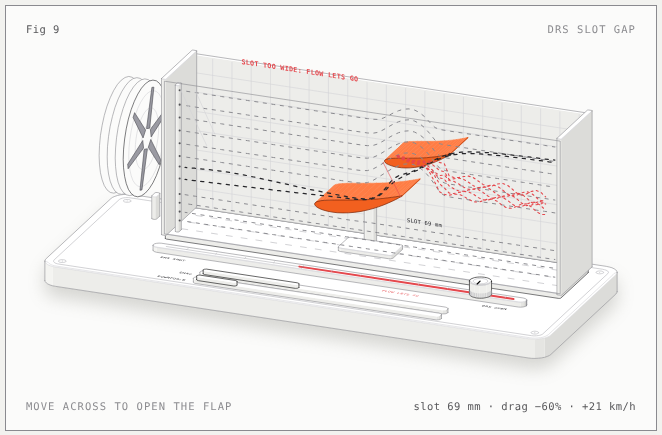

# anatomy-tryouts

Interactive isometric figures: small physical machines that explain an idea. Built with the anatomy skill's kit (`kit/`).

| Figure | Idea |
|---|---|
| [accretion](accretion/) | Planetary accretion: a body sweeping up dust, with gravitational focusing |
| [threshold-sieve](threshold-sieve/) | Classifier threshold: sliding the sieve trades precision against recall |
| [class-imbalance](class-imbalance/) | Why accuracy lies: thin the positives and watch precision collapse |
| [friction-circle](friction-circle/) | One budget of tyre grip shared between braking, accelerating and cornering |
| [tyre-window](tyre-window/) | Why a tyre only works in a narrow temperature window |
| [chai-boilover](chai-boilover/) | Why milk boils over and water doesn't: a skin traps the steam |
| [undercut](undercut/) | Why pitting early can beat a car ahead: fresh tyres repay the stop |
| [ackermann](ackermann/) | Why a kart's inside wheel turns more: all four wheels must aim at one centre |
| [drs-slot-gap](drs-slot-gap/) | Why opening a wing's slot gap cuts drag: the flow over the flap lets go |

More are planned: see [IDEAS.md](IDEAS.md).

## Run one
```bash
cd accretion
node build.mjs          # dark  -> accretion.html
node build.mjs --light  # light -> accretion-light.html
```
Open the HTML file in a browser. Move the pointer across the figure to change the time-lapse; R restarts.













